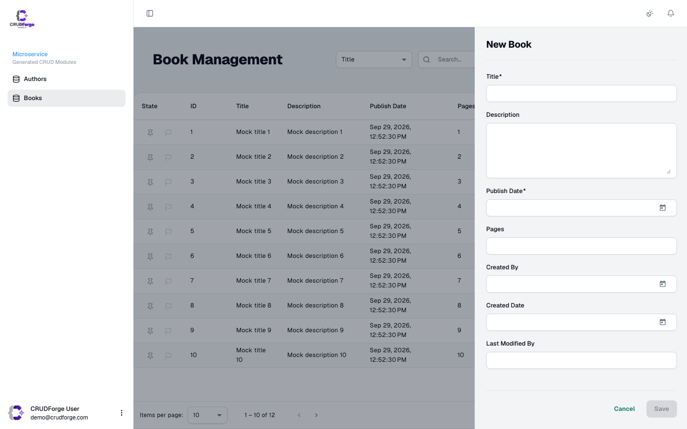
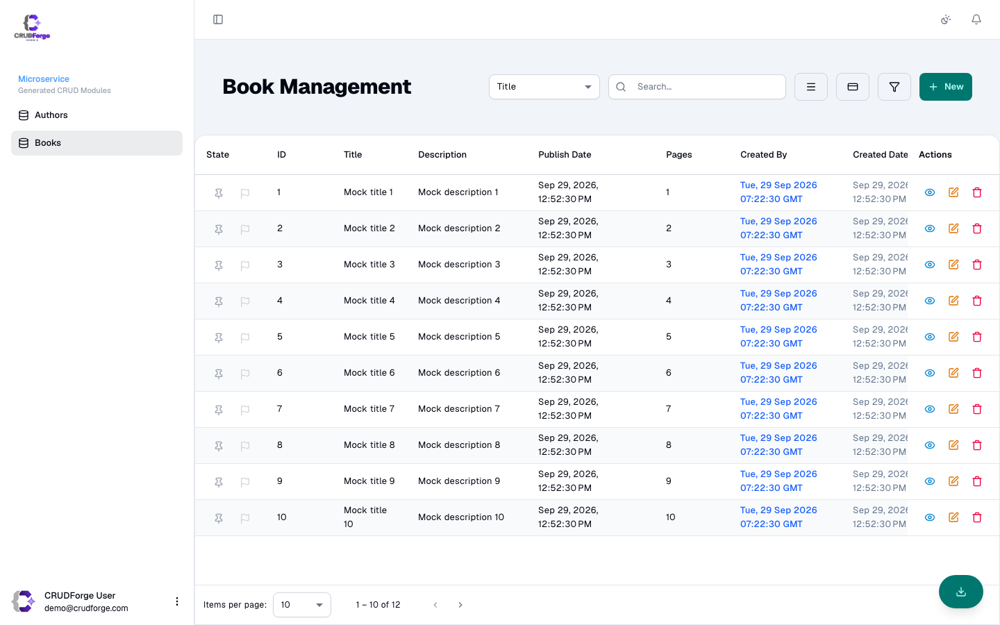
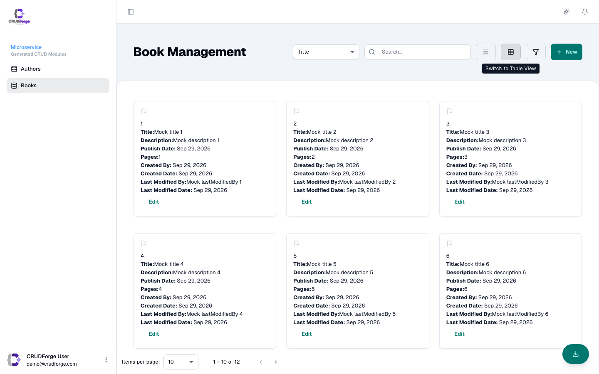

These options live under `ui` and `fields` in `config/crudforge.config.yml` (or `--preferences`).

## formMode — New and Edit Together

```yaml
ui:
  formMode: sidebar   # or page
```

| Value | Behavior |
|-------|----------|
| `sidebar` | New and edit open the list `mat-drawer` / `.cforge-form-drawer`. |
| `page` | New routes to `…/new`, edit routes to `…/:id/edit`. |



> [!IMPORTANT]
> Never mix modes (e.g. edit as page while new is sidebar). New/edit drawer openings mount a fresh form and clear selected state upon closing.

## searchMode

```yaml
ui:
  searchMode: field   # default — JHipster field.contains
  # searchMode: global  # only if backend API accepts `query` (Elasticsearch-style)
```



- `field`: Filters with type-aware `field.contains` criteria.
- `global`: Sends full-text search string to backend `query` endpoint.

## viewMode & Responsive Cards

```yaml
ui:
  viewMode: table
  cardBreakpointPx: 640
  gridCols:
    mobile: 1
    tablet: 2
    desktop: 3
```



Lists observe container width: below `cardBreakpointPx` (default `640px`), the list automatically transitions to cards. Manual table/card toggle selections are saved in `localStorage`, and widening the viewport restores the saved preference.

## Per-Field Input Formatting

Configure case formatting on specific string or text blob fields:

```yaml
fields:
  entities:
    Province:
      fields:
        provinceCode: { inputFormat: uppercase }
        provinceName: { inputFormat: lowercase }
        index: { inputFormat: none }
```

- `uppercase`: Forces input, paste, edit models, and outgoing payloads to uppercase.
- `lowercase`: Forces values to lowercase.
- `none`: Preserves user case (default).
- Formatting accessors preserve cursor/selection position and support IME composition.

## Audit Fields & Column Preferences

```yaml
fields:
  audit:
    hideInForms: true    # Hides createdBy, createdDate, etc. from form fields
    hideInFilters: true  # Hides audit fields from the filter drawer
    hideInSearch: true   # Hides audit fields from the search dropdown
    hideInLists: false   # Initial selection in Column Preferences dialog
```

Audit UUIDs are converted into user names in lists and cards via `AuditUserNamePipe` when Keycloak is active.

## Related

- [Theme & branding](/customization/theme-branding/)
- [Generate toggles](/customization/generate-toggles/)
- [Config keys reference](/reference/config-keys/)

