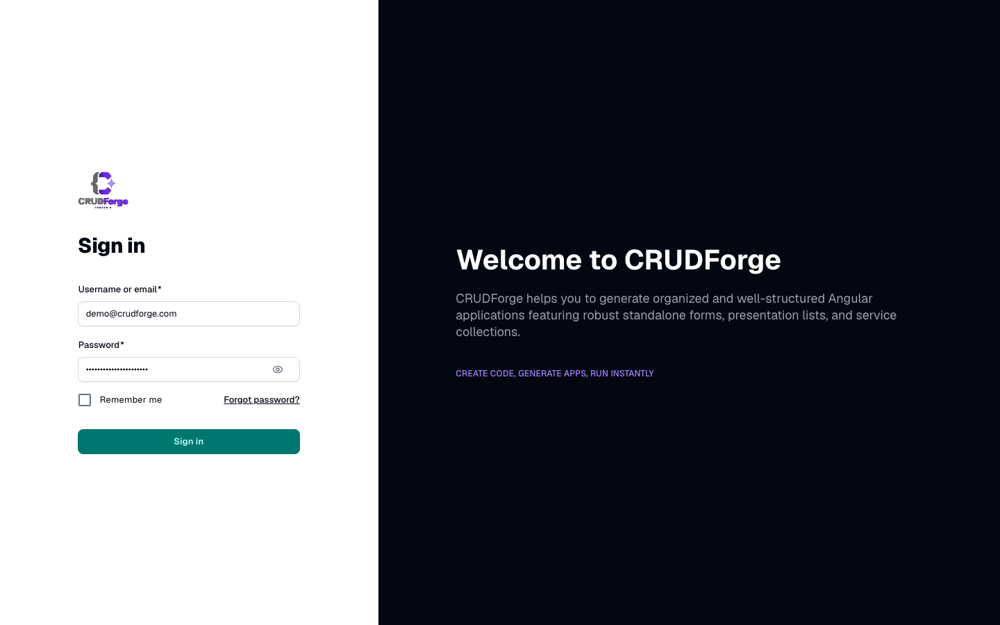
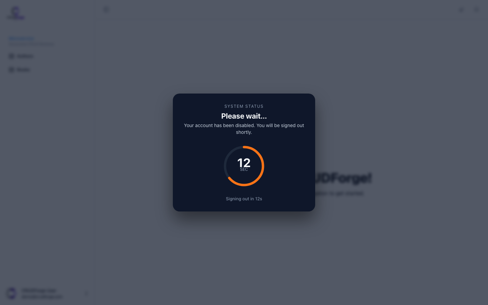

## Sign-in



Generated Fuse sign-in uses CRUDForge branding. For development and QA workflows, `auth.signInPrefill` binds the Angular login form to preset credentials (e.g. `crud` / `crud`).

## Authenticated Fuse Identity Profile

Keycloak builds bind the shared Fuse user menu and account view directly to `AuthService.profile`, derived from authenticated JWT claims:

- **Display Name Resolution**: `name` → `given_name` + `family_name` → `username` → `email`.
- **Avatar & Initials**: The `picture` claim supplies an avatar image when present; otherwise initials are generated.
- **State Hydration**: Profile state hydrates on token refresh/hydration and clears completely on logout.
- **No Client Secrets**: Uses a public OIDC client with PKCE without requiring browser-side client secrets or extra profile endpoints.

## Session Management (Default: Stay Signed In)

```yaml
auth:
  session:
    idleTimeoutMs: 0        # 0 = stay signed in until explicit logout
    persistAcrossReload: true
    crossTabSync: true
    refreshOnFocus: true
    statusProbeIntervalMs: 60000
```

- **Resilient Refresh**: Only terminal auth errors (expired refresh token) clear session tokens; network dropouts and 5xx errors retain the session.
- **Single-Flight Interceptor**: Prevents 401 stampedes when multiple requests fire simultaneously.
- **Cross-Tab Sync**: Logging out in one tab immediately clears auth in all active tabs.

Full guide: [Session & disabled account](/guides/session/).

## Disabled-Account Overlay



When `auth.disabledAccount.enabled: true`, an explicit Keycloak "account disabled" grant freezes the shell (root `app.ts` overlay) and executes a countdown before signing out.

## Theme on Auth Chrome

Primary buttons and interaction states follow root `fuseTheme` (brand violet `#791EFF`) — see [Theme & branding](/customization/theme-branding/).
