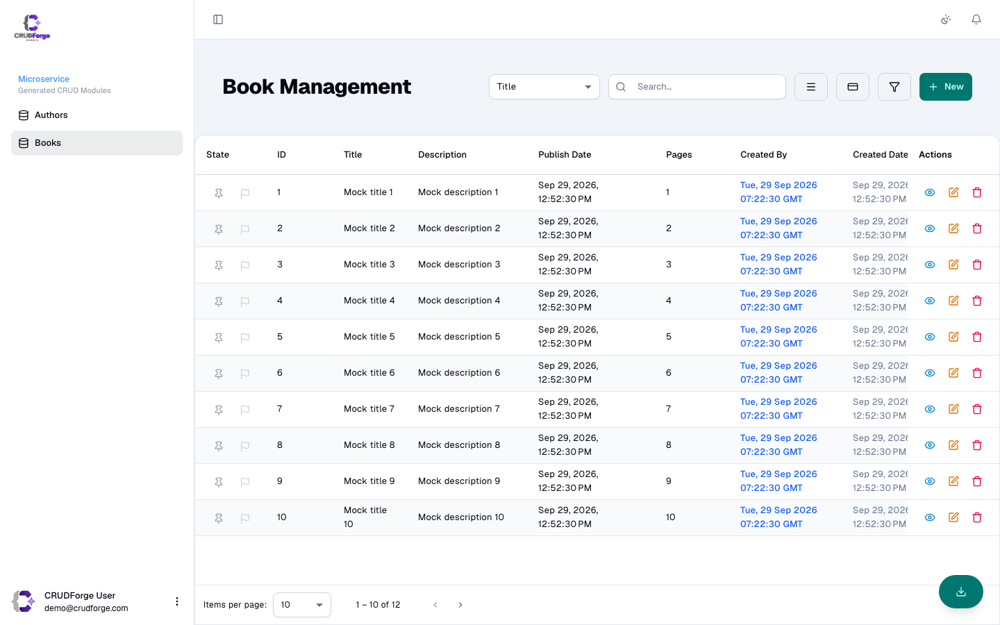
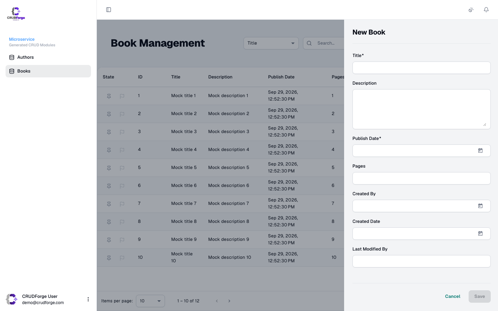
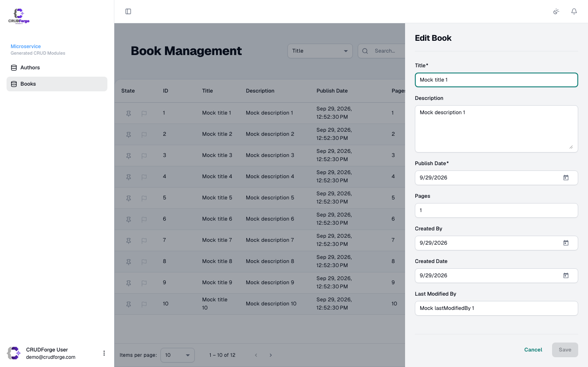
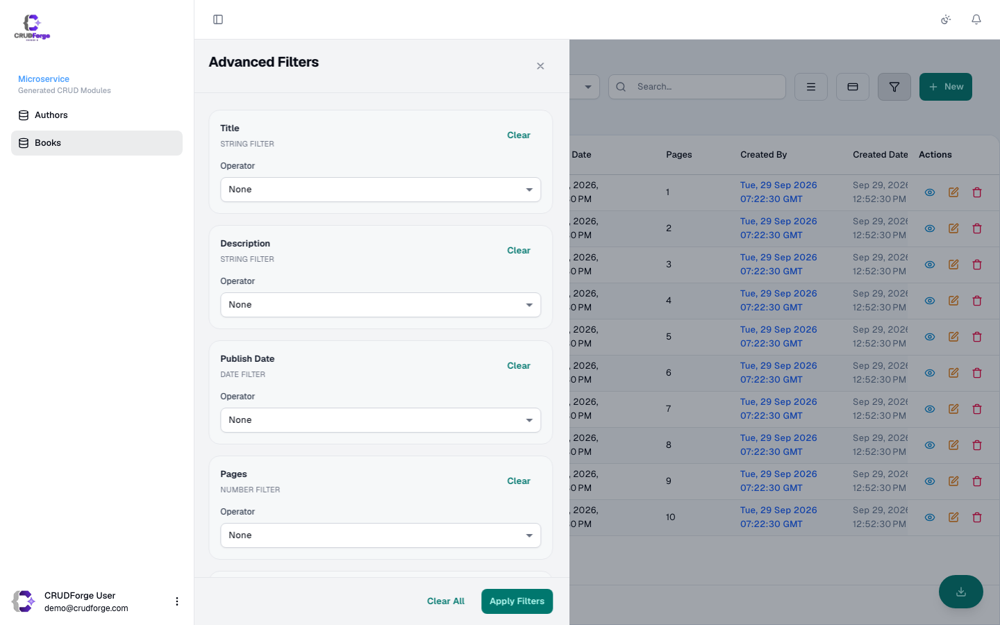
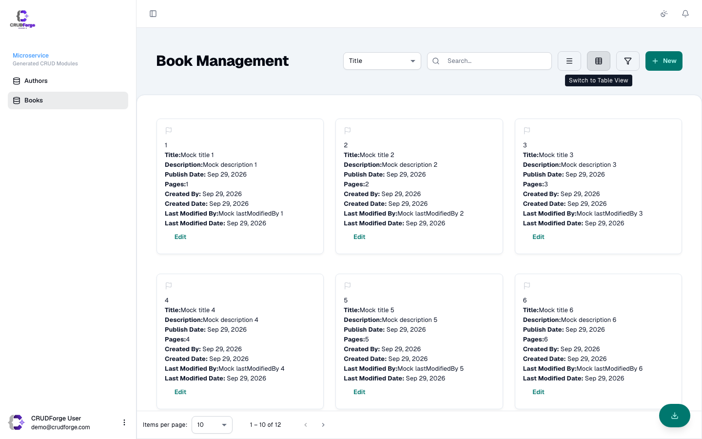
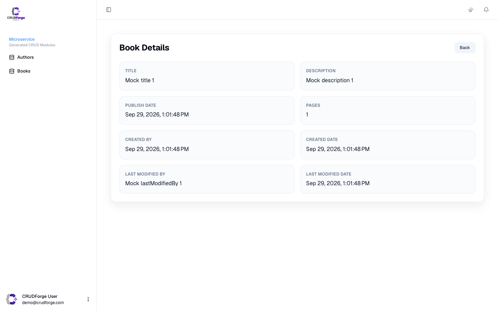
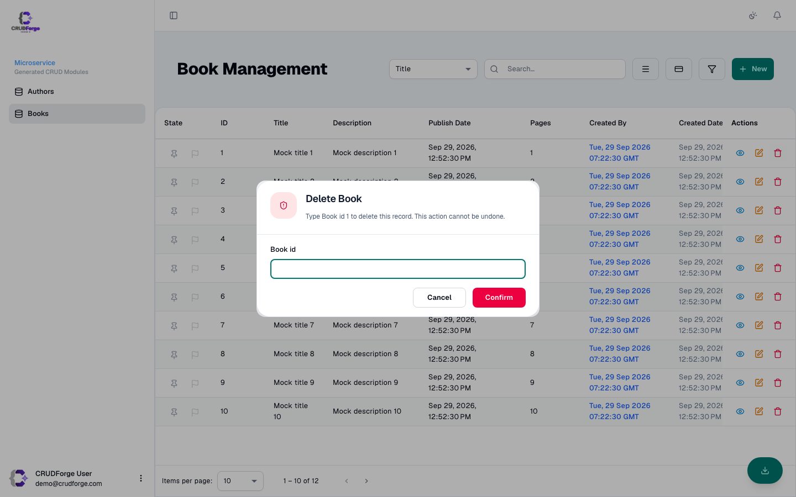

Every entity module is generated under a responsibility-based layout: presentation (list/card/detail), forms, interaction (actions/filter), settings, and service.

## List & Responsive Layout

Includes:

- Server-driven pagination (mock or real API)
- Field search (`title.contains`-style) when `ui.searchMode: field`
- Automatic responsive card layout switch below `ui.cardBreakpointPx` (default `640px`)
- Pin / flag / export affordances on the list chrome
- Column Preferences dialog with persisted browser settings and default reset
- ACL stamps (`data-screen-id`, `accessCtrl`) when Keycloak IAM is on

## Create & Edit (Same formMode)

| `ui.formMode` | New | Edit |
|---------------|-----|------|
| `sidebar` | Opens list drawer (`.cforge-form-drawer`) | Opens same drawer |
| `page` | Routes to `…/new` | Routes to `…/:id/edit` |

> [!IMPORTANT]
> Never mix modes (e.g. edit as page while new is sidebar). Drawer openings mount a fresh form and clear selected entity on close.

## Field Formatting & Audit Resolution

- **Per-Field Input Formatting**: Configure `uppercase` or `lowercase` per text field in `fields.entities.<Entity>.fields.<Field>.inputFormat`. Form controls preserve cursor positions and handle IME composition.
- **Audit Field Controls**: Audit fields (`createdBy`, `createdDate`, `lastModifiedBy`, `lastModifiedDate`) are hidden by default in forms, filter drawers, and search dropdowns.
- **Name Resolution Pipe**: When Keycloak is active, `AuditUserNamePipe` converts user UUIDs into first + last names via cached lookups.

## Filters

Advanced filter panel per entity with type-specific operators (strings, numbers, dates, booleans, enums).

## Card View

Toggle between table and card layouts. Breakpoints and grid column counts are configurable via `ui.gridCols` and `ui.cardBreakpointPx`.

## Detail

Read-only property sheet with relationship links when schema relationships are generated.

## Delete

Shared confirmation dialogs (and typed confirmation for destructive deletes) under `apps/shared/` or centralized shared packs.

## Related Customization

- [UI modes](/customization/ui-modes/)
- [Generate toggles](/customization/generate-toggles/)
- [Config keys reference](/reference/config-keys/)
