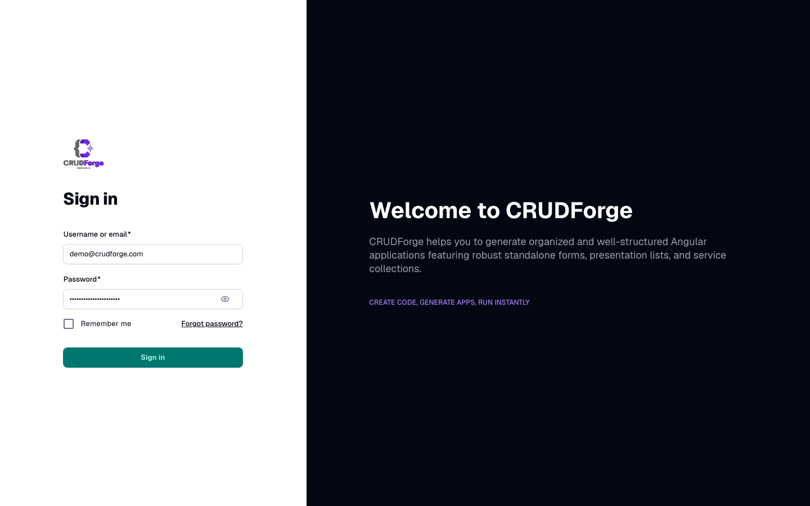
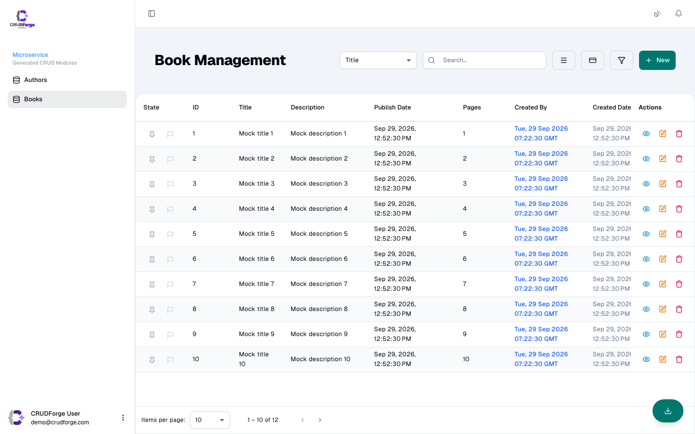
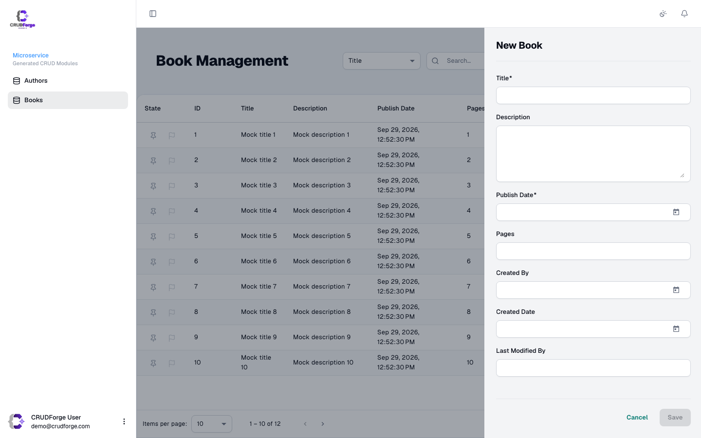
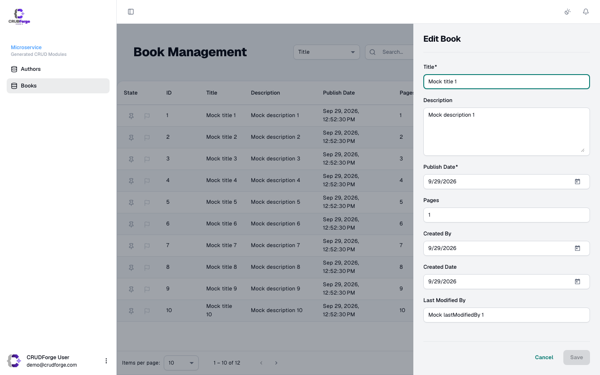
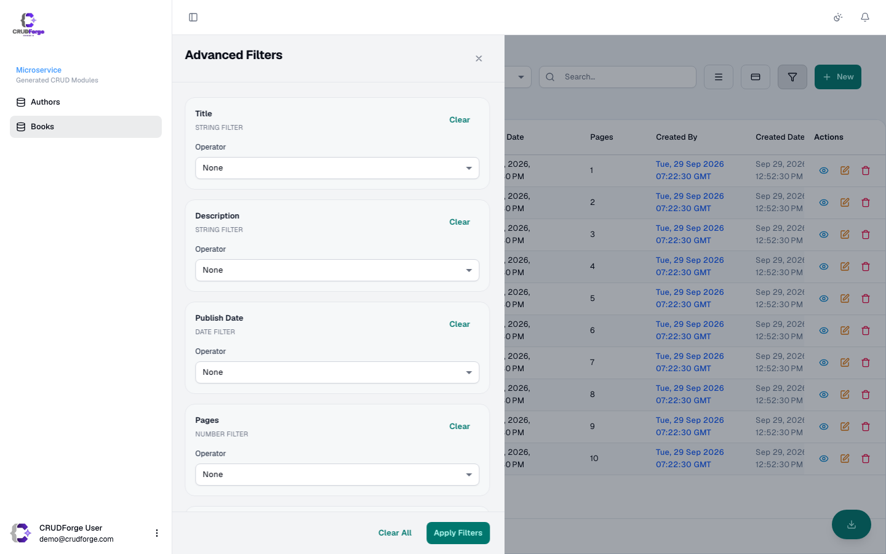
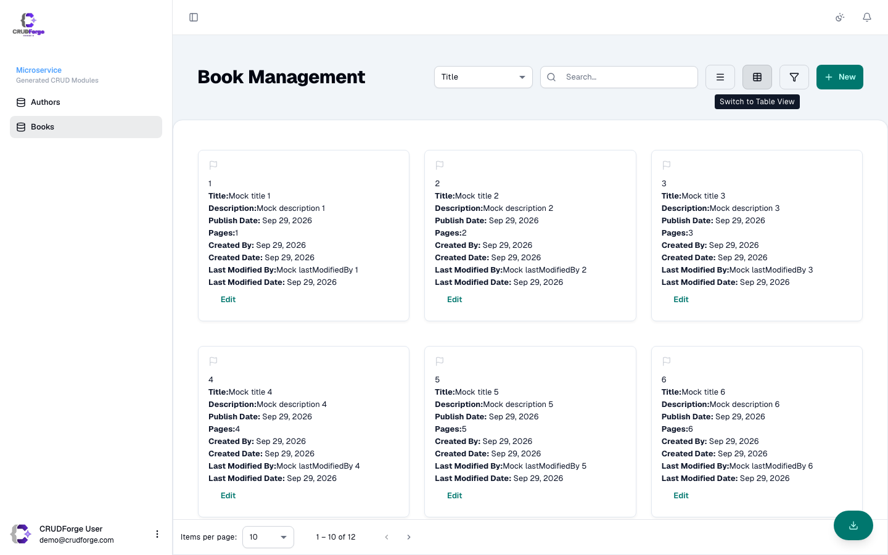
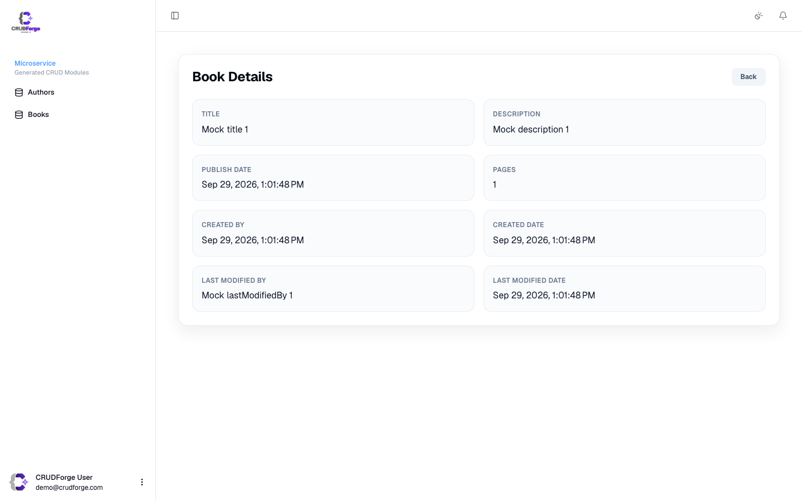
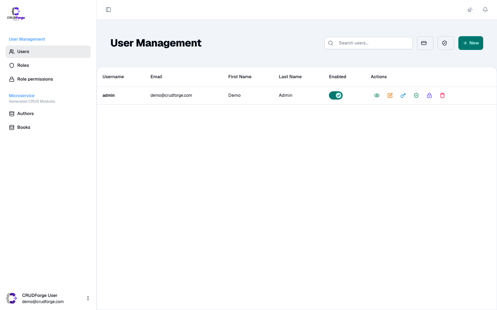
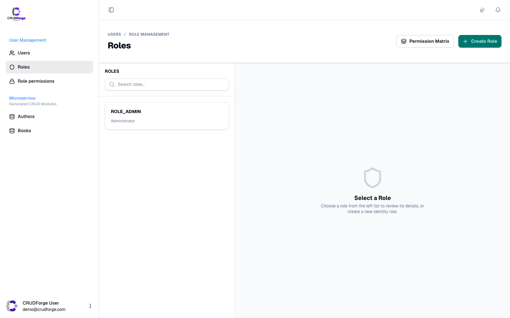

CRUDForge turns a GDL or JDL domain into a Fuse Angular admin app: entity CRUD, optional Keycloak auth, IAM overlay, input formatting, and clean layout.

## At a Glance

| Area | What you get |
|------|----------------|
| **Entity CRUD** | List, card, form (sidebar or page), detail, filter, actions, column preferences |
| **Schema Formats** | GDL and JDL domain blueprints with validation |
| **Search & Filter** | Field `contains` by default (`ui.searchMode: field`) or Elasticsearch `global` |
| **Input Formatting** | Real-time `uppercase` / `lowercase` with composition & cursor preservation |
| **Rendering** | Single Page Application (`spa`) or Node Universal (`ssr`) |
| **Auth** | Keycloak OIDC pack — mock or live Admin Service middleware |
| **IAM** | Users, roles, screen access matrices, component ACL stamps |
| **Session** | Stay signed in across reloads, resilient refresh, disabled-account overlay |
| **Branding** | Clean layout, transparent brand PNGs, root `#791EFF` theming |

## Gallery

### Sign-in

Clean split layout: wordmark + credentials on the left, welcome copy on the right. No social login or Fuse demo banners.

### Entity list

Paginated table, field search, New / filter / export / pin / flag actions, and responsive card switching.

### Sidebar form (new & edit)

`ui.formMode: sidebar` — **new and edit share the same drawer**. Page mode routes both to full pages instead.

### Filters

### Card view

### Detail

### User Management (IAM)

Users, roles, and **screen access** matrices — see [IAM overlay](/features/iam/) and [Users, roles & screen access](/guides/iam-access/).

## Dig Deeper

- [Entity CRUD](/features/entity-crud/)
- [IAM overlay](/features/iam/)
- [Auth UX](/features/auth-ux/)
- [UI modes customization](/customization/ui-modes/)
- [Configuration guide](/guides/configuration/)

