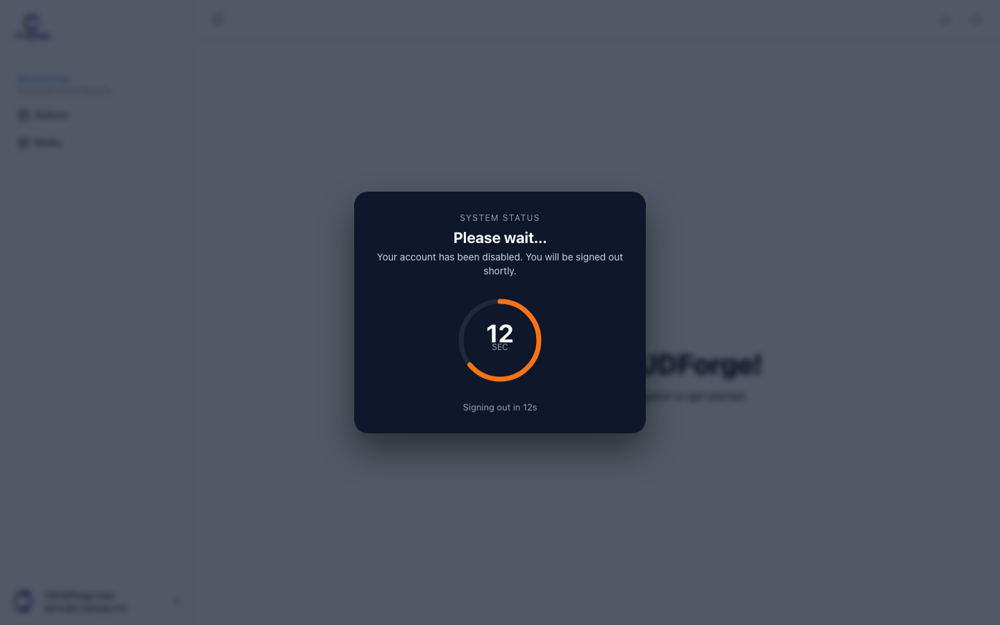

## Session Defaults

CRUDForge defaults session management to keep users signed in across reloads, refreshing tokens reliably without losing user work.

```yaml
auth:
  session:
    idleTimeoutMs: 0              # 0 = stay signed in until explicit logout
    persistAcrossReload: true     # Hydrates session tokens on page reload
    crossTabSync: true            # Logs out all tabs when any tab logs out
    refreshOnFocus: true          # Refreshes access token when window/tab is focused
    statusProbeIntervalMs: 60000  # Periodic refresh/status probe
```

### Key Session Behaviors

- **Terminal Auth Errors Only**: Token refresh only terminates the session on explicit invalid/expired refresh token responses (`invalid_grant`). Transient network failures and HTTP 5xx responses retain the active session.
- **Single-Flight Interceptor**: Prevents duplicate refresh requests when multiple API calls complete simultaneously during token expiration.
- **Cross-Tab Synchronization**: Uses `BroadcastChannel` / `localStorage` events to synchronize login/logout state instantly across browser tabs.

## Disabled-Account Overlay

```yaml
auth:
  disabledAccount:
    enabled: false                # Set true to enable overlay protection
    countdownSeconds: 20          # Countdown duration before logout
    message: "Your account has been disabled. Please contact your administrator."
    sound: false
```

When `disabledAccount.enabled: true`:

- An explicit Keycloak "account disabled" grant error activates a full-screen frozen overlay attached directly to root `app.ts`.
- The user is shown an alert countdown before being securely signed out.
- Generic auth failures do not trigger the overlay.


